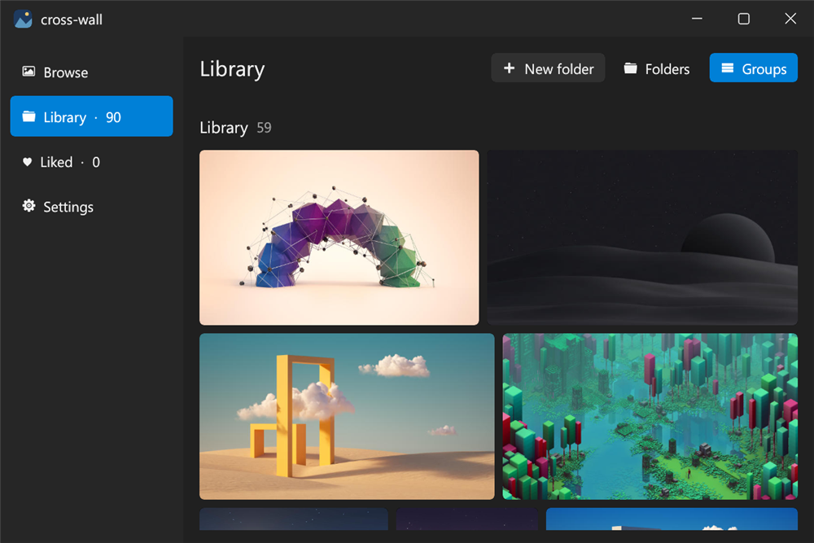

# crossWall

[](https://github.com/an-dr/cross-wall/actions/workflows/build.yml) [](https://github.com/an-dr/cross-wall/releases/latest) [](LICENSE) [](https://github.com/an-dr/bones) [](https://ai-level.dev/level-3)

A desktop wallpaper manager: find wallpapers with no account or API key, keep them organised in a folder of your own, and set them on your desktop.



## Features

- **Five photo sources, no key:** Wallhaven, Openverse, Wikimedia Commons, Lorem Picsum, and NASA Images.
- **Filters:** search, shape, and a minimum resolution that starts at your main display's.
- **Your own folder:** downloads go to its root, and your existing images and subfolders appear too.
- **Organising:** create folders, rename, move, drag onto a folder, and delete to the system trash. View by folder or as groups.
- **Likes:** stored in a hidden file inside the folder, so they stay with it.
- **Apply anywhere:** Windows, KDE Plasma, GNOME, and COSMIC.
- **Follows your system:** font, accent colour, and display scale, with dark, light, and system themes.
- **Self-updating:** installs per user, with no administrator rights.

## Install

Windows x64 or ARM64, in PowerShell:

```powershell
irm https://raw.githubusercontent.com/an-dr/cross-wall/main/scripts/install.ps1 | iex
```

Linux x64, which also needs `curl` and `unzip`:

```sh
curl -fsSL https://raw.githubusercontent.com/an-dr/cross-wall/main/scripts/install.sh | sh
```

Both verify the download's checksum, install into `~/.cross-wall`, and add the app to your application list. You can also take a zip from [Releases](https://github.com/an-dr/cross-wall/releases/latest), unpack it, and run `cross-wall-app`, or press Install in its Settings.

To remove the app, press Unregister in Settings, then delete `~/.cross-wall`. Your wallpaper folder stays.

## Use it

1. Open **Browse** and pick a source. Search with Enter, and more photos load as you scroll.
2. In **Settings** or **Library**, choose your wallpaper folder.
3. Hover a photo to **Like**, **Download**, or **Apply** it. Click it for a full-window preview, and step through photos with the arrow keys.
4. Open **Library** to organise your folder. Right-click an item to rename, move, or delete it.

Photos belong to their creators. The preview shows a licence where the source gives one, so check it before using a photo beyond your own desktop. Wallhaven images are uploaded by users and often state none.

## Build from source

```sh
git clone --recurse-submodules https://github.com/an-dr/cross-wall
cd cross-wall
cargo run -p cross-wall
```

Needs a Rust toolchain, a C compiler, CMake, and Ninja, because bones builds SDL3 from source. On Linux, run `cargo xtask linux-packages` inside `vendor/bones` to list the packages it also needs.

Run the tests with `cargo test --workspace`. To package and publish, see [docs/releasing.md](docs/releasing.md).

## Documentation

Start at [docs/index.md](docs/index.md) for use cases, architecture, desktop support, and decisions.

## Built with AI

This project is developed with AI agents, at [AI Level 3](https://ai-level.dev/level-3).

## License

MIT. See [LICENSE](LICENSE).
