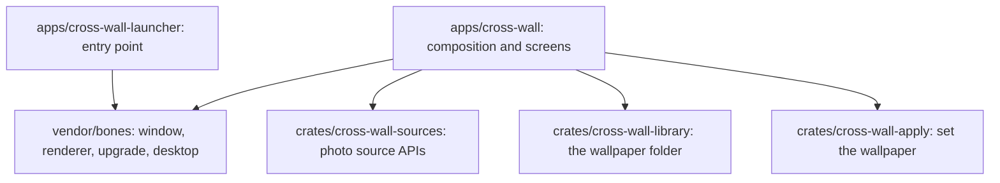

# Architecture

crossWall is a native desktop application that embeds the [bones](https://github.com/an-dr/bones) engine. It talks to photo source APIs over HTTPS, keeps wallpapers in a folder the user chooses, and asks the desktop environment to change its wallpaper.

| Part | Responsibility | Use cases |
| --- | --- | --- |
| host | Composes bones; draws every screen with egui; owns settings and paths; maps a source's photo to the credit the library keeps | all |
| sources | One search and download call over five keyless photo sources; no UI or bones dependency | BROWSE, LIBRARY-01 |
| library | The wallpaper folder: listing, organising, and likes and credits in its metadata file; no dependency on sources | LIBRARY, SETUP-02 |
| apply | Detects the desktop and sets the wallpaper; its desktop detection also picks the host's look | APPLY-01 |
| launcher | Stable entry point selecting the newest installed version | INSTALL, UPDATE |

## Guarantees

- The frame thread never waits on network or disk. Settings and log lines are written by threads of their own.
- The library works offline.
- An interrupted download never appears in the library.
- Organising never overwrites a file, and deleting goes to the system trash. An unreadable metadata file is set aside under a new name and reported, never replaced.
- The app writes only to its own data folders, the chosen wallpaper folder, and the desktop's wallpaper setting.
